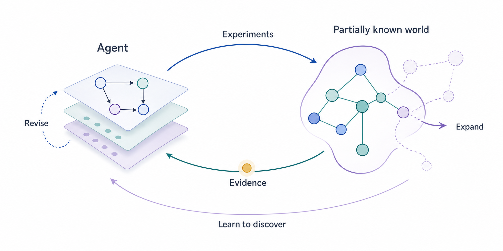

  

<h1 align="center">Awesome Open World Discovery</h1>

  <strong>Acquire evidence. Discover mechanisms. Learn to discover.</strong> 
  A curated research guide to discovery agents, learning methods, and evaluation.

  
  
  
  

  <a href="https://owd-ai.github.io/awesome-open-world-discovery/">Research observatory ↗</a> · <a href="#what-is-owd">What is OWD?</a> · <a href="#why-owd">Why this focus?</a> · <a href="#updates">Latest papers</a> · <a href="#contents">Browse the list</a> · <a href="CONTRIBUTING.md">Contribute</a>

Literature checked through 2026-10-19 · Papers, author blogs, code, and benchmarks

## 🧭 What is Open World Discovery?

> **Our working definition:** Open World Discovery connects research on how agents acquire, construct, and revise knowledge through exploration and learning in incompletely understood or changing worlds. This broad agenda brings together discovering unknowns, developing verifiable and reusable knowledge, and improving the ability to discover.

The central loop connects **hypotheses, informative actions, evidence, and revision**. Its outputs should be checked against independent observations, interventions, or executable/formal verifiers. Learning to discover asks how experience improves this loop across investigations.

[View the diagram at full size](assets/open-world-discovery.png)

**What makes the world open?** The current model or problem formulation may be incomplete: evidence can call for a different mechanism, a new variable, or a revised question. Openness is relative to what the agent is given and allowed to change. Bounded discovery tasks help study individual components; see the [scope guide](docs/taxonomy.md#positioning).

### Why Open World Discovery?

Discovery involves deciding what to investigate, gathering evidence, testing explanations, and carrying knowledge into future investigations. Representations, reasoning, training, and agent systems each contribute to this process.

**We use Open World Discovery as a shared research agenda connecting these contributions.** It brings together work on learning from unknowns, generating and validating discoveries, and improving discovery capabilities over time. By organizing methods, systems, and evaluation around common questions, this list aims to help researchers understand how individual advances can support the discovery process as a whole. See [the research scope and connections to related fields](docs/taxonomy.md#positioning).

**Download the catalog:** [BibTeX](references.bib) · [JSON](data/resources.json)

## 📰 Latest Papers

**[Explore the research observatory →](https://owd-ai.github.io/awesome-open-world-discovery/#updates)**

The latest 10 source-checked papers from our daily monitor · Updated 2026-10-21.

Visit the website for summaries, figures, today's updates, and the full research library.

| Date | Paper |
| --- | --- |
| 2026-10-21 | [VX-One: Typed, Calibrated Decision Heads for Real-Time Perimeter Triage - An empirical study of unknown-attack honesty, cascade gray zones, and calibration under drift](https://arxiv.org/abs/2610.30090) |
| 2026-10-21 | [Toward Recursive Self-Improvement in Physical AI](https://arxiv.org/abs/2610.29677) |
| 2026-10-21 | [SCDM: Scalable Causal Discovery in Nonlinear Temporal Systems with Meta-Learning](https://arxiv.org/abs/2610.29992) |
| 2026-10-21 | [Residual-Based Causal Discovery via Pretrained In-Context Quantile Regression](https://arxiv.org/abs/2610.29530) |
| 2026-10-21 | [PreCoMem: Predictive Cognitive Memory for Self-Evolving Long-Term Dialogue Agents](https://arxiv.org/abs/2610.29467) |
| 2026-10-21 | [OMAR: Open-World Multi-Attribute Reasoning for Scene-Conditioned Shelf Organization](https://arxiv.org/abs/2610.29761) |
| 2026-10-21 | [Memory-Centric Continual Learning for AI Agents](https://arxiv.org/abs/2610.29357) |
| 2026-10-21 | [Looking Ahead: Modeling Future Evolution in Autoregressive Video Generation](https://arxiv.org/abs/2610.29989) |
| 2026-10-21 | [Harness Scaling for Generalizable Agentic Reinforcement Learning](https://arxiv.org/abs/2610.29458) |
| 2026-10-21 | [GuideEvolve: Self-Evolving Agent Framework with Expert Guidance and 3Ts Mechanisms](https://arxiv.org/abs/2610.30017) |

## 🗂️ Contents

| Topic | Research question | Works |
| --- | --- | ---: |
| 📚 [Discovery Foundations](#foundations) | What constitutes a discovery? | 13 |
| 🧩 [Discovery Representations](#causality) | What representations enable discovery? | 13 |
| 🔬 [Discovery Reasoning](#sci_methods) | How should agents formulate and test hypotheses? | 16 |
| 🧠 [Discovery Training](#learning) | How can we train agents to discover? | 23 |
| 🔄 [Continual Discovery](#adaptation) | How can agents learn from ongoing investigations? | 25 |
| 🛠️ [Discovery Systems](#systems) | How can we build reliable discovery systems? | 24 |
| 🌱 [Open-Ended Discovery](#open_ended) | How can agents expand the scope of discovery? | 15 |
| 📊 [Discovery Evaluation](#benchmarks) | How can we measure progress in discovery? | 23 |

[🔗 Related lists](#related) · [🤝 Contributing](#contributing)

Each work appears once under its primary contribution; see the [classification guide](docs/taxonomy.md#categories) for category scopes. Entries are grouped by publication year, newest first. Each work keeps its paper, code, project, and dataset links together, followed by authors and paper-time affiliations. Full attribution is recorded in the [catalog data](data/resources.json).

## 📚 Discovery Foundations

*What constitutes a discovery?*

### 2026

- **A Survey of Self-Evolving Agents: What, When, How, and Where to Evolve on the Path to Artificial Super Intelligence** · *[TMLR 2026](https://openreview.net/pdf?id=CTr3bovS5F)* · [Paper](https://arxiv.org/abs/2507.21046) · [List](https://github.com/CharlesQ9/Self-Evolving-Agents) 
  Huan-ang Gao et al. · Princeton University; Princeton AI Lab; Tsinghua University; +14 institutions
- **Causal Discovery in the Era of Agents** · *[arXiv 2026 (preprint)](https://arxiv.org/abs/2606.23608)* · [Paper](https://arxiv.org/abs/2606.23608) 
  Yujia Zheng et al. · Carnegie Mellon University; Mohamed bin Zayed University of Artificial Intelligence
- **Discovery Foundation Models: Toward Open-Ended Discovery Intelligence** · *[arXiv 2026 (preprint)](https://arxiv.org/abs/2609.15973)* · [Paper](https://arxiv.org/abs/2609.15973) · [Research resources](https://github.com/Gen-Verse/DFM-Plans) · [Project](https://phai-labs.com/collaborate/) 
  Ling Yang, Zhenfei Yin, Yingcheng Wu · DFM Scientist Collaboration Program

### 2025

- **Agentic AI for Scientific Discovery: A Survey of Progress, Challenges, and Future Directions** · *[ICLR AgenticAI Workshop 2025](https://openreview.net/forum?id=TyCYakX9BD)* · [Paper](https://arxiv.org/abs/2503.08979) 
  Mourad Gridach et al. · IQVIA
- **Autonomous Agents for Scientific Discovery: Orchestrating Scientists, Language, Code, and Physics** · *[arXiv 2025 (preprint)](https://arxiv.org/abs/2510.09901)* · [Paper](https://arxiv.org/abs/2510.09901) 
  Lianhao Zhou et al. · Texas A&M University; Harvard Medical School; Massachusetts Institute of Technology; +2 institutions
- **From AI for Science to Agentic Science: A Survey on Autonomous Scientific Discovery** · *[arXiv 2025 (preprint)](https://arxiv.org/abs/2508.14111)* · [Paper](https://arxiv.org/abs/2508.14111) · [Project](https://agenticscience.github.io/) · [List](https://github.com/AgenticScience/Awesome-Agent-Scientists) 
  Jiaqi Wei et al. · Shanghai AI Laboratory; Zhejiang University; Fudan University; +7 institutions
- **From Automation to Autonomy: A Survey on Large Language Models in Scientific Discovery** · *[EMNLP 2025](https://aclanthology.org/2025.emnlp-main.895/)* · [Paper](https://arxiv.org/abs/2505.13259) · [List](https://github.com/HKUST-KnowComp/Awesome-LLM-Scientific-Discovery) 
  Tianshi Zheng et al. · HKUST
- **Towards Scientific Intelligence: A Survey of LLM-based Scientific Agents** · *[arXiv 2025 (preprint)](https://arxiv.org/abs/2503.24047)* · [Paper](https://arxiv.org/abs/2503.24047) 
  Shuo Ren et al. · Institute of Automation, Chinese Academy of Sciences; University of Chinese Academy of Sciences; Wuhan AI Research

### 2024

- **Open-Endedness is Essential for Artificial Superhuman Intelligence** · *[ICML 2024](https://proceedings.mlr.press/v235/hughes24a.html)* · [Paper](https://arxiv.org/abs/2406.04268) 
  Edward Hughes et al. · Google DeepMind

### 2020

- **A Review of Open-World Learning and Steps Toward Open-World Learning Without Labels** · *[arXiv 2020 (preprint)](https://arxiv.org/abs/2011.12906)* · [Paper](https://arxiv.org/abs/2011.12906) 
  Mohsen Jafarzadeh et al. · University of Colorado Colorado Springs

### 2009

- **Causal Inference in Statistics An Overview** · *[Statistics Surveys 2009](https://projecteuclid.org/journals/statistics-surveys/volume-3/issue-none/Causal-inference-in-statistics-An-overview/10.1214/09-SS057.full)* · [Paper](https://escholarship.org/uc/item/36w8n7pg) · [Author PDF](https://ftp.cs.ucla.edu/pub/stat_ser/r350.pdf) 
  Judea Pearl · UCLA
- **Driven by Compression Progress: A Simple Principle Explains Essential Aspects of Subjective Beauty, Novelty, Surprise, Interestingness, Attention, Curiosity, Creativity, Art, Science, Music, Jokes** · *[ABiALS 2008, LNCS 5499 2009](https://link.springer.com/chapter/10.1007/978-3-642-02565-5_4)* · [Paper](https://arxiv.org/abs/0812.4360) 
  Jürgen Schmidhuber · TU Munich; IDSIA

### 2005

- **A tutorial introduction to the minimum description length principle** · *[Advances in Minimum Description Length (MIT Press) 2005 (chapter)](https://homepages.cwi.nl/~pdg/publicationpage.html)* · [Paper](https://arxiv.org/abs/math/0406077) 
  Peter Grünwald · Centrum Wiskunde & Informatica (CWI)

[↑ Contents](#contents)

## 🧩 Discovery Representations

*What representations enable discovery?*

### 2026

- **CIDER-FM: Foundation Models for Causal Inference from Diverse Experimental Regimes** · *[arXiv 2026 (preprint)](https://arxiv.org/abs/2609.39523)* · [Paper](https://arxiv.org/abs/2609.39523) 
  Yuche Gao et al. · University of Cambridge; Max Planck Institute for Intelligent Systems; Prior Labs; +3 institutions

### 2023

- **DreamCoder: Growing generalizable, interpretable knowledge with wake-sleep Bayesian program learning** · *[Philosophical Transactions of the Royal Society A 2023](https://doi.org/10.1098/rsta.2022.0050)* · [Paper](https://arxiv.org/abs/2006.08381) · [Code](https://github.com/ellisk42/ec) 
  Kevin Ellis et al. · MIT; NeuroSpin; Center for Brains, Minds and Machines
- **Learning to Induce Causal Structure** · *[ICLR 2023](https://openreview.net/forum?id=hp_RwhKDJ5)* · [Paper](https://arxiv.org/abs/2204.04875) 
  Nan Rosemary Ke et al. · DeepMind; Mila; Polytechnique Montréal; +2 institutions

### 2022

- **Amortized Inference for Causal Structure Learning** · *[NeurIPS 2022](https://proceedings.neurips.cc/paper_files/paper/2022/hash/54f7125dee9b8b3dc798bb9a082b09e2-Abstract-Conference.html)* · [Paper](https://arxiv.org/abs/2205.12934) · [Code](https://github.com/larslorch/avici) 
  Lars Lorch et al. · ETH Zurich; Max Planck Institute for Intelligent Systems
- **Bayesian Structure Learning with Generative Flow Networks** · *[UAI 2022](https://proceedings.mlr.press/v180/deleu22a.html)* · [Paper](https://arxiv.org/abs/2202.13903) · [Code](https://github.com/tristandeleu/jax-dag-gflownet) 
  Tristan Deleu et al. · Mila, Université de Montréal; Technical University of Munich; KTH Royal Institute of Technology; +1 institutions
- **CITRIS: Causal Identifiability from Temporal Intervened Sequences** · *[ICML 2022](https://proceedings.mlr.press/v162/lippe22a.html)* · [Paper](https://arxiv.org/abs/2202.03169) · [Code](https://github.com/phlippe/CITRIS) 
  Phillip Lippe et al. · University of Amsterdam; MIT-IBM Watson AI Lab; Qualcomm AI Research
- **Weakly supervised causal representation learning** · *[NeurIPS 2022](https://proceedings.neurips.cc/paper_files/paper/2022/hash/fa567e2b2c870f8f09a87b6e73370869-Abstract-Conference.html)* · [Paper](https://arxiv.org/abs/2203.16437) · [Code](https://github.com/Qualcomm-AI-research/weakly-supervised-causal-representation-learning) 
  Johann Brehmer, Pim de Haan, Phillip Lippe, Taco Cohen · Qualcomm AI Research; University of Amsterdam

### 2021

- **DiBS: Differentiable Bayesian Structure Learning** · *[NeurIPS 2021](https://proceedings.neurips.cc/paper_files/paper/2021/hash/ca6ab34959489659f8c3776aaf1f8efd-Abstract.html)* · [Paper](https://arxiv.org/abs/2105.11839) · [Code](https://github.com/larslorch/dibs) 
  Lars Lorch, Jonas Rothfuss, Bernhard Schölkopf, Andreas Krause · ETH Zurich; Max Planck Institute for Intelligent Systems
- **Towards Causal Representation Learning** · *[Proceedings of the IEEE 2021](https://ieeexplore.ieee.org/document/9363924/)* · [Paper](https://arxiv.org/abs/2102.11107) 
  Bernhard Schölkopf et al. · Max Planck Institute for Intelligent Systems; ETH Zurich; Mila / Université de Montréal; +2 institutions

### 2020

- **Joint Causal Inference from Multiple Contexts** · *[JMLR 2020](https://jmlr.org/papers/v21/17-123.html)* · [Paper](https://jmlr.org/papers/v21/17-123.html) · [Code](https://github.com/caus-am/jci) 
  Joris M. Mooij, Sara Magliacane, Tom Claassen · University of Amsterdam; MIT-IBM Watson AI Lab / IBM Research; Radboud University

### 2018

- **DAGs with NO TEARS: Continuous Optimization for Structure Learning** · *[NeurIPS 2018](https://proceedings.neurips.cc/paper_files/paper/2018/hash/e347c51419ffb23ca3fd5050202f9c3d-Abstract.html)* · [Paper](https://arxiv.org/abs/1803.01422) · [Code](https://github.com/xunzheng/notears) 
  Xun Zheng, Bryon Aragam, Pradeep Ravikumar, Eric P. Xing · Carnegie Mellon University

### 2016

- **Causal inference using invariant prediction: identification and confidence intervals** · *[JRSS Series B 2016](https://academic.oup.com/jrsssb/article/78/5/947/7040653)* · [Paper](https://arxiv.org/abs/1501.01332) · [Code (R)](https://cran.r-project.org/package=InvariantCausalPrediction) 
  Jonas Peters, Peter Bühlmann, Nicolai Meinshausen · Max Planck Institute for Intelligent Systems; ETH Zurich

### 2014

- **Causal Discovery with Continuous Additive Noise Models** · *[JMLR 2014](https://jmlr.org/papers/v15/peters14a.html)* · [Paper](https://jmlr.org/papers/v15/peters14a.html) 
  Jonas Peters, Joris M. Mooij, Dominik Janzing, Bernhard Schölkopf · ETH Zurich; University of Amsterdam; Radboud University; +1 institutions

[↑ Contents](#contents)

## 🔬 Discovery Reasoning

*How should agents formulate and test hypotheses?*

### 2026

- **Searching for What Matters: Open-Ended Discovery of Multiple Hypotheses with Agentic Data Exploration** · *[arXiv 2026 (preprint)](https://arxiv.org/abs/2610.17874)* · [Paper](https://arxiv.org/abs/2610.17874) 
  Sanchit Kabra et al. · Virginia Tech; Amazon

### 2025

- **LLM-SR: Scientific Equation Discovery via Programming with Large Language Models** · *[ICLR 2025](https://proceedings.iclr.cc/paper_files/paper/2025/hash/28df8e730c054c5331855fd4d5403ba9-Abstract-Conference.html)* · [Paper](https://arxiv.org/abs/2404.18400) · [Code](https://github.com/deep-symbolic-mathematics/LLM-SR) 
  Parshin Shojaee et al. · Virginia Tech; Carnegie Mellon University; Allen Institute for AI

### 2024

- **Causal Reasoning and Large Language Models: Opening a New Frontier for Causality** · *[TMLR 2024](https://openreview.net/forum?id=RkaqxxAOfN)* · [Paper](https://arxiv.org/abs/2305.00050) · [Code](https://github.com/py-why/pywhy-llm) 
  Emre Kıcıman, Robert Ness, Amit Sharma, Chenhao Tan · Microsoft Research; University of Chicago
- **Mathematical discoveries from program search with large language models** · *[Nature 2024](https://www.nature.com/articles/s41586-023-06924-6)* · [Paper](https://www.nature.com/articles/s41586-023-06924-6) · [Code](https://github.com/google-deepmind/funsearch) 
  Bernardino Romera-Paredes et al. · Google DeepMind; University of Wisconsin-Madison; University of Lyon

### 2023

- **Active Causal Structure Learning with Advice** · *[ICML 2023](https://proceedings.mlr.press/v202/choo23a.html)* · [Paper](https://proceedings.mlr.press/v202/choo23a.html) · [Code](https://github.com/cxjdavin/active-causal-structure-learning-with-advice) 
  Davin Choo, Themistoklis Gouleakis, Arnab Bhattacharyya · National University of Singapore
- **Faster sorting algorithms discovered using deep reinforcement learning** · *[Nature 2023](https://www.nature.com/articles/s41586-023-06004-9)* · [Paper](https://www.nature.com/articles/s41586-023-06004-9) · [Code](https://github.com/google-deepmind/alphadev) 
  Daniel J. Mankowitz et al. · DeepMind; Google
- **Interpretable Machine Learning for Science with PySR and SymbolicRegression.jl** · *[arXiv 2023 (preprint)](https://arxiv.org/abs/2305.01582)* · [Paper](https://arxiv.org/abs/2305.01582) · [Code](https://github.com/MilesCranmer/PySR) · [Code (Julia)](https://github.com/MilesCranmer/SymbolicRegression.jl) 
  Miles Cranmer · Princeton University; Flatiron Institute
- **ReAct: Synergizing Reasoning and Acting in Language Models** · *[ICLR 2023](https://arxiv.org/abs/2210.03629)* · [Paper](https://arxiv.org/abs/2210.03629) · [Project](https://react-lm.github.io/) · [Code](https://github.com/ysymyth/ReAct) 
  Shunyu Yao et al. · Princeton University; Google Research
- **Scaling deep learning for materials discovery** · *[Nature 2023](https://www.nature.com/articles/s41586-023-06735-9)* · [Paper](https://www.nature.com/articles/s41586-023-06735-9) · [Code & Data](https://github.com/google-deepmind/materials_discovery) 
  Amil Merchant et al. · Google DeepMind; Google Research

### 2022

- **A Unified Framework for Deep Symbolic Regression** · *[NeurIPS 2022](https://proceedings.neurips.cc/paper_files/paper/2022/hash/dbca58f35bddc6e4003b2dd80e42f838-Abstract-Conference.html)* · [Paper](https://proceedings.neurips.cc/paper_files/paper/2022/hash/dbca58f35bddc6e4003b2dd80e42f838-Abstract-Conference.html) · [Code](https://github.com/brendenpetersen/deep-symbolic-regression) 
  Mikel Landajuela et al. · Lawrence Livermore National Laboratory
- **Discovering faster matrix multiplication algorithms with reinforcement learning** · *[Nature 2022](https://www.nature.com/articles/s41586-022-05172-4)* · [Paper](https://www.nature.com/articles/s41586-022-05172-4) · [Code](https://github.com/google-deepmind/alphatensor) 
  Alhussein Fawzi et al. · DeepMind
- **How to Stay Curious while Avoiding Noisy TVs using Aleatoric Uncertainty Estimation** · *[ICML 2022](https://proceedings.mlr.press/v162/mavor-parker22a.html)* · [Paper](https://proceedings.mlr.press/v162/mavor-parker22a.html) · [Code](https://github.com/self-supervisor/Escaping-Stochastic-Traps-With-Aleatoric-Mapping-Agents) 
  Augustine Mavor-Parker, Kimberly Young, Caswell Barry, Lewis Griffin · University College London; Boston University
- **Interventions, Where and How? Experimental Design for Causal Models at Scale** · *[NeurIPS 2022](https://proceedings.neurips.cc/paper_files/paper/2022/hash/98a5c0470e57d518ade4e56c6ee0b363-Abstract-Conference.html)* · [Paper](https://arxiv.org/abs/2203.02016) · [Code](https://github.com/yannadani/cbed) 
  Panagiotis Tigas et al. · University of Oxford; KTH Royal Institute of Technology; Max Planck Institute for Intelligent Systems; +1 institutions

### 2021

- **Deep symbolic regression: Recovering mathematical expressions from data via risk-seeking policy gradients** · *[ICLR 2021](https://openreview.net/forum?id=m5Qsh0kBQG)* · [Paper](https://arxiv.org/abs/1912.04871) · [Code](https://github.com/brendenpetersen/deep-symbolic-regression) 
  Brenden K. Petersen et al. · Lawrence Livermore National Laboratory
- **Symbolic Regression via Deep Reinforcement Learning Enhanced Genetic Programming Seeding** · *[NeurIPS 2021](https://proceedings.neurips.cc/paper/2021/hash/d073bb8d0c47f317dd39de9c9f004e9d-Abstract.html)* · [Paper](https://proceedings.neurips.cc/paper/2021/hash/d073bb8d0c47f317dd39de9c9f004e9d-Abstract.html) · [Code](https://github.com/brendenpetersen/deep-symbolic-regression) 
  T. Nathan Mundhenk et al. · Lawrence Livermore National Laboratory

### 2016

- **VIME: Variational Information Maximizing Exploration** · *[NeurIPS 2016](https://proceedings.neurips.cc/paper_files/paper/2016/hash/abd815286ba1007abfbb8415b83ae2cf-Abstract.html)* · [Paper](https://arxiv.org/abs/1605.09674) · [Code](https://github.com/openai/vime) 
  Rein Houthooft et al. · UC Berkeley; Ghent University / imec; OpenAI

[↑ Contents](#contents)

## 🧠 Discovery Training

*How can we train agents to discover?*

### 2026

- **AgentGym-RL: Training LLM Agents for Long-Horizon Decision Making through Multi-Turn Reinforcement Learning** · *[ICLR 2026](https://proceedings.iclr.cc/paper_files/paper/2026/hash/1571ce1ff735be4551db50887043726e-Abstract-Conference.html)* · [Paper](https://arxiv.org/abs/2509.08755) · [Code](https://github.com/woooodyy/AgentGym-RL) · [Project](https://AgentGym-RL.github.io) · [HF Dataset](https://huggingface.co/datasets/AgentGym/AgentGym-RL-Data-ID) 
  Zhiheng Xi et al. · Fudan University; ByteDance Seed; Shanghai Innovation Institute
- **CHART: A Harness-Rotation Curriculum for Harness-Robust Search Agents** · *[arXiv 2026 (preprint)](https://arxiv.org/abs/2609.22247)* · [Paper](https://arxiv.org/abs/2609.22247) 
  Xinlu Zhang et al. · Amazon
- **Compute Aligned Training: Optimizing for Test Time Inference** · *[arXiv 2026 (preprint)](https://arxiv.org/abs/2604.24957)* · [Paper](https://arxiv.org/abs/2604.24957) · [Code](https://github.com/adamoosya/compute-aligned-training) 
  Adam Ousherovitch, Ambuj Tewari · University of Michigan
- **Explore More, Drift Less: Outcome-Only Reinforcement Learning Can Suffice for Long-Horizon Interactive Agents** · *[arXiv 2026 (preprint)](https://arxiv.org/html/2609.01245v1)* · [Paper](https://arxiv.org/html/2609.01245v1) 
  Liming Pu et al.
- **Scaling Scientific Discovery Environments for Turn-Level Agentic RL** · *[arXiv 2026 (preprint)](https://arxiv.org/html/2607.28990v1)* · [Paper](https://arxiv.org/html/2607.28990v1) 
  Yucheng Xu et al. · Shanghai AI Laboratory
- **SPROUT: Scaling Agentic Reinforcement Learning for Long-Horizon Software Engineering** · *[arXiv 2026 (preprint)](https://arxiv.org/html/2610.14405v1)* · [Paper](https://arxiv.org/html/2610.14405v1) · [Code](https://github.com/RISE-X-Lab/SPROUT) · [Project](https://rise-x-lab.github.io/SPROUT/) 
  Mengyang Liu et al. · Shanghai Jiao Tong University; Amazon; Nanjing University; +2 institutions

### 2025

- **AgentEvolver: Towards Efficient Self-Evolving Agent System** · *[arXiv 2025 (preprint)](https://arxiv.org/abs/2511.10395)* · [Paper](https://arxiv.org/abs/2511.10395) · [Code](https://github.com/modelscope/AgentEvolver) · [Project](https://modelscope.github.io/AgentEvolver/) 
  Yunpeng Zhai et al. · Tongyi Lab, Alibaba Group
- **DeepSeek-R1: Incentivizing Reasoning Capability in LLMs via Reinforcement Learning** · *[Nature 2025](https://www.nature.com/articles/s41586-025-09422-z)* · [Paper](https://arxiv.org/abs/2501.12948) · [Code](https://github.com/deepseek-ai/DeepSeek-R1) · [HF Model](https://huggingface.co/deepseek-ai/DeepSeek-R1) 
  DeepSeek-AI
- **RAGEN: Understanding Self-Evolution in LLM Agents via Multi-Turn Reinforcement Learning** · *[arXiv 2025 (preprint)](https://arxiv.org/abs/2504.20073)* · [Paper](https://arxiv.org/abs/2504.20073) · [Code](https://github.com/RAGEN-AI/RAGEN) · [Project](https://ragen-ai.github.io/) 
  Zihan Wang et al. · Northwestern University; University of Washington; Stanford University; +4 institutions
- **Search-R1: Training LLMs to Reason and Leverage Search Engines with Reinforcement Learning** · *[COLM 2025](https://arxiv.org/abs/2503.09516)* · [Paper](https://arxiv.org/abs/2503.09516) · [Code](https://github.com/PeterGriffinJin/Search-R1) · [HF Collection](https://huggingface.co/collections/PeterJinGo/search-r1-67d1a021202731cb065740f5) · [HF Model (7B)](https://huggingface.co/PeterJinGo/SearchR1-nq_hotpotqa_train-qwen2.5-7b-em-ppo) · [HF Dataset](https://huggingface.co/datasets/PeterJinGo/nq_hotpotqa_train) 
  Bowen Jin et al. · University of Illinois Urbana-Champaign; University of Massachusetts Amherst; Google Cloud AI Research
- **WebRL: Training LLM Web Agents via Self-Evolving Online Curriculum Reinforcement Learning** · *[ICLR 2025](https://proceedings.iclr.cc/paper_files/paper/2025/hash/c66e1fcc9691aae706250638f36f681b-Abstract-Conference.html)* · [Paper](https://arxiv.org/abs/2411.02337) · [Code](https://github.com/THUDM/WebRL) · [HF Model (GLM-9B)](https://huggingface.co/THUDM/webrl-glm-4-9b) · [HF Model (Llama-8B)](https://huggingface.co/THUDM/webrl-llama-3.1-8b) · [HF Model (Llama-70B)](https://huggingface.co/THUDM/webrl-llama-3.1-70b) · [HF Reward Model](https://huggingface.co/THUDM/webrl-orm-llama-3.1-8b) 
  Zehan Qi et al. · Tsinghua University; Zhipu AI

### 2024

- **AgentTuning: Enabling Generalized Agent Abilities for LLMs** · *[Findings of ACL 2024](https://aclanthology.org/2024.findings-acl.181/)* · [Paper](https://arxiv.org/abs/2310.12823) · [Code](https://github.com/THUDM/AgentTuning) · [Project](https://thudm.github.io/AgentTuning/) · [HF Model (70B)](https://huggingface.co/THUDM/agentlm-70b) · [HF Dataset](https://huggingface.co/datasets/THUDM/AgentInstruct) 
  Aohan Zeng et al. · Tsinghua University; Zhipu.AI
- **Beyond Human Data: Scaling Self-Training for Problem-Solving with Language Models** · *[TMLR 2024](https://arxiv.org/abs/2312.06585)* · [Paper](https://arxiv.org/abs/2312.06585) 
  Avi Singh et al. · Google DeepMind; Mila
- **Eureka: Human-Level Reward Design via Coding Large Language Models** · *[ICLR 2024](https://proceedings.iclr.cc/paper_files/paper/2024/hash/70c26937fbf3d4600b69a129031b66ec-Abstract-Conference.html)* · [Paper](https://arxiv.org/abs/2310.12931) · [Project](https://eureka-research.github.io) · [Code](https://github.com/eureka-research/Eureka) 
  Yecheng Jason Ma et al. · NVIDIA; University of Pennsylvania; California Institute of Technology; +1 institutions
- **Re-ReST: Reflection-Reinforced Self-Training for Language Agents** · *[EMNLP 2024](https://aclanthology.org/2024.emnlp-main.861/)* · [Paper](https://arxiv.org/abs/2406.01495) · [Code](https://github.com/PlusLabNLP/Re-ReST) 
  Zi-Yi Dou et al. · UCLA

### 2023

- **A Meta-Reinforcement Learning Algorithm for Causal Discovery** · *[CLeaR 2023](https://proceedings.mlr.press/v213/sauter23a.html)* · [Paper](https://arxiv.org/abs/2207.08457) · [Code](https://github.com/sa-and/MCD) 
  Andreas Sauter, Erman Acar, Vincent François-Lavet · Vrije Universiteit Amsterdam; University of Amsterdam
- **ReST meets ReAct: Self-Improvement for Multi-Step Reasoning LLM Agent** · *[arXiv 2023 (preprint)](https://arxiv.org/abs/2312.10003)* · [Paper](https://arxiv.org/abs/2312.10003) 
  Renat Aksitov et al. · Google Research; Google DeepMind; Google

### 2022

- **STaR: Bootstrapping Reasoning With Reasoning** · *[NeurIPS 2022](https://proceedings.neurips.cc/paper_files/paper/2022/hash/639a9a172c044fbb64175b5fad42e9a5-Abstract-Conference.html)* · [Paper](https://arxiv.org/abs/2203.14465) 
  Eric Zelikman, Yuhuai Wu, Jesse Mu, Noah D. Goodman · Stanford University; Google Research

### 2021

- **Deep Adaptive Design Amortizing Sequential Bayesian Experimental Design** · *[ICML 2021](https://proceedings.mlr.press/v139/foster21a.html)* · [Paper](https://proceedings.mlr.press/v139/foster21a.html) · [Code](https://github.com/ae-foster/dad) 
  Adam Foster, Desi R Ivanova, Ilyas Malik, Tom Rainforth · University of Oxford

### 2020

- **VariBAD: A Very Good Method for Bayes-Adaptive Deep RL via Meta-Learning** · *[ICLR 2020](https://arxiv.org/abs/1910.08348)* · [Paper](https://arxiv.org/abs/1910.08348) · [Code](https://github.com/lmzintgraf/varibad) 
  Luisa Zintgraf et al. · University of Oxford; Latent Logic; Microsoft Research

### 2019

- **Causal Reasoning from Meta-reinforcement Learning** · *[arXiv 2019 (preprint)](https://arxiv.org/abs/1901.08162)* · [Paper](https://arxiv.org/abs/1901.08162) 
  Ishita Dasgupta et al. · DeepMind; UCL; Harvard University

### 2017

- **Hindsight Experience Replay** · *[NeurIPS 2017](https://proceedings.neurips.cc/paper_files/paper/2017/hash/453fadbd8a1a3af50a9df4df899537b5-Abstract.html)* · [Paper](https://arxiv.org/abs/1707.01495) 
  Marcin Andrychowicz et al. · OpenAI

### 1999

- **Policy Invariance under Reward Transformations Theory and Application to Reward Shaping** · *[ICML 1999](https://people.eecs.berkeley.edu/~russell/papers/icml99-shaping.pdf)* · [Paper](https://ai.stanford.edu/~ang/papers/shaping-icml99.pdf) · [Author PDF](https://people.eecs.berkeley.edu/~russell/papers/icml99-shaping.pdf) 
  Andrew Y. Ng, Daishi Harada, Stuart Russell · UC Berkeley

[↑ Contents](#contents)

## 🔄 Continual Discovery

*How can agents learn from ongoing investigations?*

### 2026

- **ASCENT: Online Test-Time Training of Long-Horizon Agents via Self-Distillation of Verified Experience** · *[arXiv 2026 (preprint)](https://arxiv.org/html/2610.05303v1)* · [Paper](https://arxiv.org/html/2610.05303v1) · [Project](https://artificer-ai-lab.github.io/ASCENT/) 
  Haodong Lu, Dong Gong · UNSW Sydney
- **HarnessTTT: Learn to Optimize Harness at Test-Time for Scientific Discovery** · *[arXiv 2026 (preprint)](https://arxiv.org/abs/2610.17370)* · [Paper](https://arxiv.org/abs/2610.17370) · [Code](https://github.com/SaFo-Lab/Self_Adapt_Harness) · [Project](https://gray311.github.io/harnessrl/) · [HF Dataset](https://huggingface.co/datasets/gray311/HarnessRL) 
  Yingzi Ma et al. · University of Wisconsin-Madison; NVIDIA; Johns Hopkins University; +2 institutions
- **Learning to Discover at Test Time** · *[ICML 2026](https://proceedings.mlr.press/v306/yuksekgonul26a.html)* · [Paper](https://arxiv.org/html/2601.16175v1) · [Code](https://github.com/test-time-training/discover) · [Project](https://test-time-training.github.io/discover) 
  Mert Yuksekgonul et al. · Stanford University; NVIDIA; Astera Institute; +2 institutions
- **No Time Like the Present: Agentic Test-Time Training for LLM Agents** · *[arXiv 2026 (preprint)](https://arxiv.org/abs/2607.03441)* · [Paper](https://arxiv.org/abs/2607.03441) 
  Yanbo Wang et al. · Kuaishou Technology
- **Skills on the Fly: Test-Time Adaptive Skill Synthesis for LLM Agents** · *[arXiv 2026 (preprint)](https://arxiv.org/abs/2605.16986)* · [Paper](https://arxiv.org/abs/2605.16986) · [Code](https://github.com/Hydr0pon1c/Skills-on-the-fly) 
  Jingxing Wang et al. · Shanghai Jiao Tong University; OPPO Research Institute
- **Test-Time Training with Next-Token Prediction** · *[arXiv 2026 (preprint)](https://arxiv.org/abs/2606.21803)* · [Paper](https://arxiv.org/abs/2606.21803) · [Code](https://github.com/yancyou/TTT-NTP) 
  Xuan Ouyang, Zefan Cai, Junjie Hu · University of Wisconsin-Madison
- **TTCS: Test-Time Curriculum Synthesis for Self-Evolving** · *[arXiv 2026 (preprint)](https://arxiv.org/abs/2601.22628)* · [Paper](https://arxiv.org/abs/2601.22628) · [Code](https://github.com/XMUDeepLIT/TTCS) 
  Chengyi Yang et al. · Xiamen University; Washington University in St. Louis; Renmin University of China

### 2025

- **Learning to (Learn at Test Time): RNNs with Expressive Hidden States** · *[ICML 2025](https://proceedings.mlr.press/v267/sun25h.html)* · [Paper](https://arxiv.org/abs/2407.04620) · [Code (PyTorch)](https://github.com/test-time-training/ttt-lm-pytorch) · [Code (JAX)](https://github.com/test-time-training/ttt-lm-jax) 
  Yu Sun et al. · Stanford University; UC San Diego; UC Berkeley; +1 institutions
- **Self-Adapting Language Models** · *[NeurIPS 2025](https://proceedings.neurips.cc/paper_files/paper/2025/hash/6b41e04c41726e2a60e456d0a2b961ab-Abstract-Conference.html)* · [Paper](https://arxiv.org/html/2506.10943v1) · [Code](https://github.com/Continual-Intelligence/SEAL) · [Blog](https://jyopari.github.io/posts/seal) 
  Adam Zweiger et al. · MIT
- **The Surprising Effectiveness of Test-Time Training for Few-Shot Learning** · *[ICML 2025](https://proceedings.mlr.press/v267/akyurek25a.html)* · [Paper](https://arxiv.org/abs/2411.07279) · [Code (BBH)](https://github.com/adamzweiger/Fewshot-TTT) · [Code (ARC)](https://github.com/ekinakyurek/marc) · [HF Model](https://huggingface.co/ekinakyurek/marc-8B-finetuned-llama3) · [HF Adapters](https://huggingface.co/ekinakyurek/marc-lora-adapters-8B-finetuned-llama3) 
  Ekin Akyürek et al. · MIT
- **Titans: Learning to Memorize at Test Time** · *[NeurIPS 2025](https://proceedings.neurips.cc/paper_files/paper/2025/hash/a4ca07aa108036f80cbb5b82285fd4b1-Abstract-Conference.html)* · [Paper](https://arxiv.org/abs/2501.00663) · [Blog](https://research.google/blog/titans-miras-helping-ai-have-long-term-memory/) 
  Ali Behrouz, Peilin Zhong, Vahab Mirrokni · Google Research
- **TTRL: Test-Time Reinforcement Learning** · *[NeurIPS 2025](https://proceedings.neurips.cc/paper_files/paper/2025/hash/be690ea16f005c174f6c4102a5970e67-Abstract-Conference.html)* · [Paper](https://arxiv.org/abs/2504.16084) · [Code](https://github.com/PRIME-RL/TTRL) 
  Yuxin Zuo et al. · Tsinghua University; Shanghai AI Laboratory

### 2024

- **Test-Time Training on Nearest Neighbors for Large Language Models** · *[ICLR 2024](https://proceedings.iclr.cc/paper_files/paper/2024/hash/f02f1185b97518ab5bd7ebde466992d3-Abstract-Conference.html)* · [Paper](https://arxiv.org/abs/2305.18466) · [Code](https://github.com/socialfoundations/tttlm) · [HF Model (retriever)](https://huggingface.co/socialfoundations/roberta-large-pile-lr2e-5-bs16-8gpu-1700000) 
  Moritz Hardt, Yu Sun · Max Planck Institute for Intelligent Systems; University of Tübingen / Tübingen AI Center; Stanford University

### 2023

- **Human-Timescale Adaptation in an Open-Ended Task Space** · *[ICML 2023](https://proceedings.mlr.press/v202/bauer23a.html)* · [Paper](https://arxiv.org/abs/2301.07608) 
   Adaptive Agent Team et al. · DeepMind
- **Reflexion: Language Agents with Verbal Reinforcement Learning** · *[NeurIPS 2023](https://proceedings.neurips.cc/paper_files/paper/2023/hash/1b44b878bb782e6954cd888628510e90-Abstract-Conference.html)* · [Paper](https://arxiv.org/abs/2303.11366) · [Code](https://github.com/noahshinn/reflexion) 
  Noah Shinn et al. · Northeastern University; Massachusetts Institute of Technology; Princeton University

### 2022

- **Continual Test-Time Domain Adaptation** · *[CVPR 2022](https://openaccess.thecvf.com/content/CVPR2022/html/Wang_Continual_Test-Time_Domain_Adaptation_CVPR_2022_paper.html)* · [Paper](https://arxiv.org/abs/2203.13591) · [Code](https://github.com/qinenergy/CoTTA) 
  Qin Wang, Olga Fink, Luc Van Gool, Dengxin Dai · ETH Zurich; Max Planck Institute for Informatics; EPFL; +1 institutions
- **Efficient Test-Time Model Adaptation without Forgetting** · *[ICML 2022](https://proceedings.mlr.press/v162/niu22a.html)* · [Paper](https://arxiv.org/abs/2204.02610) · [Code](https://github.com/mr-eggplant/EATA) 
  Shuaicheng Niu et al. · South China University of Technology; Tencent AI Lab; National University of Singapore
- **Self-Initiated Open World Learning for Autonomous AI Agents** · *[AAAI Spring Symposium Series 2022](https://arxiv.org/abs/2110.11385)* · [Paper](https://arxiv.org/abs/2110.11385) 
  Bing Liu, Eric Robertson, Scott Grigsby, Sahisnu Mazumder · University of Illinois at Chicago; PAR Government Systems Corporation
- **Test-Time Training with Masked Autoencoders** · *[NeurIPS 2022](https://proceedings.neurips.cc/paper_files/paper/2022/hash/bcdec1c2d60f94a93b6e36f937aa0530-Abstract-Conference.html)* · [Paper](https://arxiv.org/abs/2209.07522) · [Project](https://yossigandelsman.github.io/ttt_mae/index.html) · [Code](https://github.com/yossigandelsman/test_time_training_mae) 
  Yossi Gandelsman, Yu Sun, Xinlei Chen, Alexei A. Efros · University of California, Berkeley; Meta AI

### 2021

- **Tent: Fully Test-time Adaptation by Entropy Minimization** · *[ICLR 2021](https://arxiv.org/abs/2006.10726)* · [Paper](https://arxiv.org/abs/2006.10726) · [Code](https://github.com/DequanWang/tent) 
  Dequan Wang et al. · University of California, Berkeley; Adobe Research
- **TTT++: When Does Self-Supervised Test-Time Training Fail or Thrive?** · *[NeurIPS 2021](https://proceedings.neurips.cc/paper_files/paper/2021/hash/b618c3210e934362ac261db280128c22-Abstract.html)* · [Paper](https://proceedings.neurips.cc/paper_files/paper/2021/file/b618c3210e934362ac261db280128c22-Paper.pdf) · [Code](https://github.com/vita-epfl/ttt-plus-plus) 
  Yuejiang Liu et al. · EPFL

### 2020

- **Test Time Training with Self Supervision for Generalization under Distribution Shifts** · *[ICML 2020](https://proceedings.mlr.press/v119/sun20b.html)* · [Paper](https://proceedings.mlr.press/v119/sun20b.html) · [Code](https://github.com/yueatsprograms/ttt_cifar_release) · [Project](https://test-time-training.github.io/) 
  Yu Sun et al. · UC Berkeley; UC San Diego

### 2019

- **Dynamic Evaluation of Transformer Language Models** · *[arXiv 2019 (preprint)](https://arxiv.org/abs/1904.08378)* · [Paper](https://arxiv.org/abs/1904.08378) · [Code](https://github.com/benkrause/dynamiceval-transformer) 
  Ben Krause, Emmanuel Kahembwe, Iain Murray, Steve Renals · University of Edinburgh
- **Open-world Learning and Application to Product Classification** · *[WWW 2019](https://doi.org/10.1145/3308558.3313644)* · [Paper](https://arxiv.org/abs/1809.06004) · [Code](https://github.com/howardhsu/Meta-Open-World-Learning) · [Blog](https://howardhsu.github.io/article/owl/) 
  Hu Xu, Bing Liu, Lei Shu, P. Yu · University of Illinois at Chicago; Tsinghua University

### 2015

- **Towards Open World Recognition** · *[CVPR 2015](https://openaccess.thecvf.com/content_cvpr_2015/html/Bendale_Towards_Open_World_2015_CVPR_paper.html)* · [Paper](https://openaccess.thecvf.com/content_cvpr_2015/html/Bendale_Towards_Open_World_2015_CVPR_paper.html) · [Author PDF](https://openaccess.thecvf.com/content_cvpr_2015/papers/Bendale_Towards_Open_World_2015_CVPR_paper.pdf) 
  Abhijit Bendale, Terrance Boult · University of Colorado at Colorado Springs

[↑ Contents](#contents)

## 🛠️ Discovery Systems

*How can we build reliable discovery systems?*

### 2026

- **Accelerating scientific discovery with Co-Scientist** · *[Nature 2026](https://www.nature.com/articles/s41586-026-10644-y)* · [Paper](https://arxiv.org/abs/2502.18864) 
  Juraj Gottweis et al. · Google Cloud AI Research; Google DeepMind; Google Research; +4 institutions
- **Agent Lightning v1.0: Towards Harnessed Agentic RL** · *[arXiv 2026 (preprint)](https://arxiv.org/abs/2608.17528)* · [Paper](https://arxiv.org/abs/2608.17528) · [Code](https://github.com/microsoft/agent-lightning) 
  Zhiyuan He et al. · Microsoft; Fudan University; Zhejiang University; +1 institutions
- **autoresearch** project · [Code](https://github.com/karpathy/autoresearch) 
  Andrej Karpathy
- **Can AI Agents Make Open-Ended Scientific Discovery? Evidence from Station** · *[arXiv 2026 (preprint)](https://arxiv.org/abs/2610.08927)* · [Paper](https://arxiv.org/abs/2610.08927) · [Code](https://github.com/dualverse-ai/station-open-reseach) · [Data](https://github.com/dualverse-ai/station-open-reseach_data) · [Project](https://dualverse-ai.github.io/station-open-reseach_data) 
  Wenyu Du, Stephen Chung · DualverseAI; The University of Hong Kong; University of Cambridge
- **CausalSteward: An Agentic Divide-Conquer-Combine Copilot for Causal Discovery** · *[arXiv 2026 (preprint)](https://arxiv.org/abs/2607.01936)* · [Paper](https://arxiv.org/abs/2607.01936) 
  Nicholas Tagliapietra et al. · TU Darmstadt; Bosch Center for Artificial Intelligence; hessian.AI; +2 institutions
- **EurekAgent: Agent Environment Engineering is All You Need For Autonomous Scientific Discovery** · *[arXiv 2026 (preprint)](https://arxiv.org/abs/2606.13662)* · [Paper](https://arxiv.org/abs/2606.13662) · [Code](https://github.com/THU-Team-Eureka/EurekAgent) 
  Amy Xin et al. · Tsinghua University; Renmin University of China
- **Harness-1: Reinforcement Learning for Search Agents with State-Externalizing Harnesses** · *[arXiv 2026 (preprint)](https://arxiv.org/abs/2606.02373)* · [Paper](https://arxiv.org/abs/2606.02373) · [Code](https://github.com/pat-jj/harness-1) · [HF Model](https://huggingface.co/pat-jj/harness-1) · [HF Dataset](https://huggingface.co/datasets/pat-jj/harness-1-train-data) 
  Pengcheng Jiang et al. · University of Illinois Urbana-Champaign; UC Berkeley; Chroma
- **Reimagining research papers as interactive and reliable AI agents** · *[Nature 2026](https://www.nature.com/articles/s41586-026-11044-y)* · [Paper](https://www.nature.com/articles/s41586-026-11044-y) · [Preprint](https://arxiv.org/abs/2509.06917) · [Code](https://github.com/jmiao24/Paper2Agent) 
  Jiacheng Miao et al. · Stanford University
- **Robin: A multi-agent system for automating scientific discovery** · *[Nature 2026](https://www.nature.com/articles/s41586-026-10652-y)* · [Paper](https://arxiv.org/abs/2505.13400) 
  Ali Essam Ghareeb et al. · FutureHouse; University of Oxford
- **The AI Scientist: Towards Fully Automated Open-Ended Scientific Discovery** · *[Nature 2026](https://www.nature.com/articles/s41586-026-10265-5)* · [Paper](https://arxiv.org/abs/2408.06292) · [Code](https://github.com/SakanaAI/AI-Scientist) 
  Chris Lu et al. · Sakana AI; University of Oxford; University of British Columbia; +2 institutions

### 2025

- **Agent Laboratory: Using LLM Agents as Research Assistants** · *[Findings of EMNLP 2025](https://aclanthology.org/2025.findings-emnlp.320/)* · [Paper](https://arxiv.org/abs/2501.04227) · [Project](https://AgentLaboratory.github.io/) · [Code](https://github.com/SamuelSchmidgall/AgentLaboratory) 
  Samuel Schmidgall et al. · AMD; Johns Hopkins University; ETH Zurich
- **Agent Lightning: Train ANY AI Agents with Reinforcement Learning** · *[arXiv 2025 (preprint)](https://arxiv.org/abs/2508.03680)* · [Paper](https://arxiv.org/abs/2508.03680) · [Code](https://github.com/microsoft/agent-lightning) 
  Xufang Luo et al. · Microsoft Research
- **AgentRxiv: Towards Collaborative Autonomous Research** · *[arXiv 2025 (preprint)](https://arxiv.org/abs/2503.18102)* · [Paper](https://arxiv.org/abs/2503.18102) · [Project](https://AgentRxiv.github.io/) · [Code](https://github.com/SamuelSchmidgall/AgentLaboratory) 
  Samuel Schmidgall, Michael Moor · Johns Hopkins University; ETH Zurich
- **AI-Researcher: Autonomous Scientific Innovation** · *[NeurIPS 2025](https://proceedings.neurips.cc/paper_files/paper/2025/hash/0d904d300a105809a2114d727851e759-Abstract-Conference.html)* · [Paper](https://arxiv.org/abs/2505.18705) · [Code](https://github.com/HKUDS/AI-Researcher) 
  Jiabin Tang, Lianghao Xia, Zhonghang Li, Chao Huang · The University of Hong Kong
- **AlphaEvolve: A coding agent for scientific and algorithmic discovery** · *[arXiv 2025 (preprint)](https://arxiv.org/abs/2506.13131)* · [Paper](https://arxiv.org/abs/2506.13131) · [Blog](https://deepmind.google/blog/alphaevolve-a-gemini-powered-coding-agent-for-designing-advanced-algorithms/) · [Results](https://github.com/google-deepmind/alphaevolve_results) 
  Alexander Novikov et al. · Google DeepMind
- **BioDiscoveryAgent: An AI Agent for Designing Genetic Perturbation Experiments** · *[ICLR 2025](https://proceedings.iclr.cc/paper_files/paper/2025/hash/4252dc94531833029000f85dc5fac792-Abstract-Conference.html)* · [Paper](https://arxiv.org/abs/2405.17631) · [Code](https://github.com/snap-stanford/BioDiscoveryAgent) 
  Yusuf Roohani et al. · Stanford University; Arc Institute; Gladstone-UCSF Institute of Genomic Immunology; +1 institutions
- **Curie: Toward Rigorous and Automated Scientific Experimentation with AI Agents** · *[arXiv 2025 (preprint)](https://arxiv.org/abs/2502.16069)* · [Paper](https://arxiv.org/abs/2502.16069) · [Code](https://github.com/Just-Curieous/Curie) 
  Patrick Tser Jern Kon et al. · University of Michigan; Cisco Systems
- **Effective Harnesses for Long Running Agents** blog · [Code](https://github.com/anthropics/claude-quickstarts/tree/main/autonomous-coding) · [Blog](https://www.anthropic.com/engineering/effective-harnesses-for-long-running-agents) 
  Justin Young · Anthropic
- **Kosmos: An AI Scientist for Autonomous Discovery** · *[arXiv 2025 (preprint)](https://arxiv.org/abs/2511.02824)* · [Paper](https://arxiv.org/abs/2511.02824) · [Results](https://github.com/EdisonScientific/kosmos-figures) 
  Ludovico Mitchener et al. · Edison Scientific; University of Oxford
- **The AI Scientist-v2: Workshop-Level Automated Scientific Discovery via Agentic Tree Search** · *[arXiv 2025 (preprint)](https://arxiv.org/abs/2504.08066)* · [Paper](https://arxiv.org/abs/2504.08066) · [Code](https://github.com/SakanaAI/AI-Scientist-v2) 
  Yutaro Yamada et al. · Sakana AI; University of British Columbia; Vector Institute; +2 institutions
- **The Virtual Lab of AI agents designs new SARS-CoV-2 nanobodies** · *[Nature 2025](https://www.nature.com/articles/s41586-025-09442-9)* · [Paper](https://www.nature.com/articles/s41586-025-09442-9) · [Code](https://github.com/zou-group/virtual_lab) 
  Kyle Swanson et al. · Stanford University; Chan Zuckerberg Biohub

### 2024

- **Augmenting large language models with chemistry tools** · *[Nature Machine Intelligence 2024](https://www.nature.com/articles/s42256-024-00832-8)* · [Paper](https://arxiv.org/abs/2304.05376) · [Code](https://github.com/ur-whitelab/chemcrow-public) · [Runs](https://github.com/ur-whitelab/chemcrow-runs) 
  Andres M Bran et al. · EPFL; University of Rochester; IBM Research Europe

### 2023

- **An autonomous laboratory for the accelerated synthesis of inorganic materials** · *[Nature 2023](https://www.nature.com/articles/s41586-023-06734-w)* · [Paper](https://www.nature.com/articles/s41586-023-06734-w) · [Code (ARROWS)](https://github.com/njszym/ARROWS) · [Code (XRD)](https://github.com/njszym/XRD-AutoAnalyzer) 
  Nathan J. Szymanski et al. · University of California, Berkeley; Lawrence Berkeley National Laboratory; Google DeepMind
- **Autonomous chemical research with large language models** · *[Nature 2023](https://www.nature.com/articles/s41586-023-06792-0)* · [Paper](https://www.nature.com/articles/s41586-023-06792-0) · [Code](https://github.com/gomesgroup/coscientist) 
  Daniil A. Boiko, Robert MacKnight, Ben Kline, Gabe Gomes · Carnegie Mellon University; Emerald Cloud Lab

[↑ Contents](#contents)

## 🌱 Open-Ended Discovery

*How can agents expand the scope of discovery?*

### 2026

- **Darwin Gödel Machine: Open-Ended Evolution of Self-Improving Agents** · *[ICLR 2026](https://proceedings.iclr.cc/paper_files/paper/2026/hash/aa5f5e6eb6f613ec412f1d948dfa21a5-Abstract-Conference.html)* · [Paper](https://arxiv.org/html/2505.22954v1) · [Code](https://github.com/jennyzzt/dgm) · [Blog](https://sakana.ai/dgm/) 
  Jenny Zhang et al. · University of British Columbia; Vector Institute; Sakana AI; +1 institutions
- **DiscoveryRSI: Recursively Learning to Discover Valuable Hypotheses** · *[arXiv 2026 (preprint)](https://arxiv.org/abs/2610.23839)* · [Paper](https://arxiv.org/abs/2610.23839) · [Code](https://github.com/Gen-Verse/DiscoveryRSI) · [HF Model](https://huggingface.co/Gen-Verse/DiscoveryRSI-27B) · [HF Dataset](https://huggingface.co/datasets/Gen-Verse/DiscoveryRSI-Hypothesis-Task-Examples) · [HF Collection](https://huggingface.co/collections/Gen-Verse/discoveryrsi) · [Demo](https://foundry-arena.rsi-arena.workers.dev/arena) 
  Jianyuan Zhong et al. · PhAI Labs; The Chinese University of Hong Kong; University of Michigan; +13 institutions
- **HELIX: Model-Harness Co-evolution for Recursive Self-Improvement** · *[arXiv 2026 (preprint)](https://arxiv.org/abs/2608.13951)* · [Paper](https://arxiv.org/abs/2608.13951) · [Code](https://github.com/HKUDS/HELIX) 
  Tianyu Fan, Chao Huang · The University of Hong Kong
- **Hyperagents** · *[arXiv 2026 (preprint)](https://arxiv.org/abs/2603.19461)* · [Paper](https://arxiv.org/abs/2603.19461) · [Code](https://github.com/facebookresearch/Hyperagents) 
  Jenny Zhang et al. · University of British Columbia; Vector Institute; University of Edinburgh; +4 institutions
- **R-Zero: Self-Evolving Reasoning LLM from Zero Data** · *[ICLR 2026](https://openreview.net/pdf?id=96apU6YzSO)* · [Paper](https://arxiv.org/abs/2508.05004) · [Code](https://github.com/Chengsong-Huang/R-Zero) · [Project](https://chengsong-huang.github.io/R-Zero.github.io/) 
  Chengsong Huang et al. · Tencent AI Seattle Lab; Washington University in St. Louis; University of Maryland, College Park; +1 institutions
- **Self-Evolving Coding Agents via Harness-Policy Optimization** · *[arXiv 2026 (preprint)](https://arxiv.org/abs/2610.22791)* · [Paper](https://arxiv.org/abs/2610.22791) · [Code](https://github.com/MSR-Orchard/Self-HPO) · [HF Model (Self-HPO)](https://huggingface.co/self-hpo/Self-HPO-Qwen3.5-35B-A3B) · [HF Model (HPO)](https://huggingface.co/self-hpo/HPO-Qwen3.5-35B-A3B) 
  Zhepei Wei et al. · Microsoft Research; University of Virginia; Carnegie Mellon University
- **SwarmRSI: Recursive Self-Improvement through Evolving Scientific Agent Swarm** · *[arXiv 2026 (preprint)](https://arxiv.org/abs/2610.20431)* · [Paper](https://arxiv.org/abs/2610.20431) 
  Qianru Meng et al. · Huawei Technologies Co., Ltd.; Leiden University; University of Groningen

### 2025

- **A Self-Improving Coding Agent** · *[arXiv 2025 (preprint)](https://arxiv.org/abs/2504.15228)* · [Paper](https://arxiv.org/abs/2504.15228) · [Code](https://github.com/MaximeRobeyns/self_improving_coding_agent) 
  Maxime Robeyns, Martin Szummer, Laurence Aitchison · University of Bristol; iGent AI
- **Absolute Zero: Reinforced Self-play Reasoning with Zero Data** · *[NeurIPS 2025](https://proceedings.neurips.cc/paper_files/paper/2025/hash/9837dc00ff67d176373268ed48042d49-Abstract-Conference.html)* · [Paper](https://arxiv.org/abs/2505.03335) · [Code](https://github.com/LeapLabTHU/Absolute-Zero-Reasoner) · [Project](https://andrewzh112.github.io/absolute-zero-reasoner/) · [HF Model](https://huggingface.co/andrewzh/Absolute_Zero_Reasoner-Coder-7b) · [HF Collection](https://huggingface.co/collections/andrewzh/absolute-zero-reasoner-68139b2bca82afb00bc69e5b) 
  Andrew Zhao et al. · Tsinghua University; Beijing Institute for General Artificial Intelligence; Penn State University
- **Automated Design of Agentic Systems** · *[ICLR 2025](https://proceedings.iclr.cc/paper_files/paper/2025/hash/36b7acf6f6010652b3f2a433774a66fe-Abstract-Conference.html)* · [Paper](https://arxiv.org/abs/2408.08435) · [Code](https://github.com/ShengranHu/ADAS) 
  Shengran Hu, Cong Lu, Jeff Clune · University of British Columbia; Vector Institute; CIFAR
- **Automating the Search for Artificial Life with Foundation Models** · *[Artificial Life 2025](https://direct.mit.edu/artl/article/31/3/368/132866/Automating-the-Search-for-Artificial-Life-With)* · [Paper](https://arxiv.org/abs/2412.17799) · [Code](https://github.com/SakanaAI/asal) · [Project](https://asal.sakana.ai/) 
  Akarsh Kumar et al. · Massachusetts Institute of Technology; Sakana AI; OpenAI; +1 institutions
- **OMNI-EPIC: Open-endedness via Models of human Notions of Interestingness with Environments Programmed in Code** · *[ICLR 2025](https://openreview.net/forum?id=Y1XkzMJpPd)* · [Paper](https://arxiv.org/abs/2405.15568) · [Code](https://github.com/maxencefaldor/omni-epic) · [Project](https://www.jennyzhangzt.com/omni-epic) 
  Maxence Faldor, Jenny Zhang, Antoine Cully, Jeff Clune · Imperial College London; University of British Columbia; Vector Institute; +1 institutions

### 2024

- **OMNI: Open-endedness via Models of human Notions of Interestingness** · *[ICLR 2024](https://www.jennyzhangzt.com/omni/)* · [Paper](https://arxiv.org/abs/2306.01711) · [Project](https://www.jennyzhangzt.com/omni/) · [Code](https://github.com/jennyzzt/omni) 
  Jenny Zhang, Joel Lehman, Kenneth Stanley, Jeff Clune · University of British Columbia; Vector Institute; Stochastic Labs; +2 institutions

### 2023

- **Voyager: An Open-Ended Embodied Agent with Large Language Models** · *[arXiv 2023 (preprint)](https://arxiv.org/abs/2305.16291)* · [Paper](https://arxiv.org/abs/2305.16291) · [Project](https://voyager.minedojo.org) · [Code](https://github.com/MineDojo/Voyager) 
  Guanzhi Wang et al. · NVIDIA; California Institute of Technology; The University of Texas at Austin; +2 institutions

### 2020

- **Enhanced POET: Open-Ended Reinforcement Learning through Unbounded Invention of Learning Challenges and their Solutions** · *[ICML 2020](https://proceedings.mlr.press/v119/wang20l.html)* · [Paper](https://arxiv.org/abs/2003.08536) · [Code](https://github.com/uber-research/poet) 
  Rui Wang et al. · Uber AI Labs; OpenAI

[↑ Contents](#contents)

## 📊 Discovery Evaluation

*How can we measure progress in discovery?*

For environment types, physical experiment access, and training interfaces, see the [benchmark guide](docs/benchmarks.md).

### 2026

- **Active Causal Discovery Benchmark: Evaluating LLM Agents Under Budgeted Interventions** · *[arXiv 2026 (preprint)](https://arxiv.org/abs/2609.31675)* · [Paper](https://arxiv.org/abs/2609.31675) 
  Sagar Deb, Devam Shah, Ashwanth Krishnan · QpiAI
- **AI Research Agents Narrow Scientific Exploration** · *[arXiv 2026 (preprint)](https://arxiv.org/abs/2605.27905)* · [Paper](https://arxiv.org/abs/2605.27905) 
  Yixuan Tang, Yi Yang · The Hong Kong University of Science and Technology
- **Autonomous Science Bench: Evaluating AI Agents for Autonomous Scientific Discovery** · *[arXiv 2026 (preprint)](https://arxiv.org/abs/2610.18449)* · [Paper](https://arxiv.org/abs/2610.18449) · [Code](https://github.com/Yibo-Wen/as-bench) · [Project](https://yibow.me/autonomous-science-bench) 
  Yibo Wen, Han Liu · Northwestern University
- **CausaLab: A Scalable Environment for Interactive Causal Discovery Toward AI Scientists** · *[arXiv 2026 (preprint)](https://arxiv.org/html/2605.26029v2)* · [Paper](https://arxiv.org/html/2605.26029v2) 
  Junlin Yang et al. · Tsinghua University; University of Illinois Urbana-Champaign; Carnegie Mellon University; +2 institutions
- **DISCERN: Can AI Agents Work Like Scientists and Guide Discovery?** · *[arXiv 2026 (preprint)](https://arxiv.org/abs/2609.33357)* · [Paper](https://arxiv.org/abs/2609.33357) · [HF Dataset](https://huggingface.co/datasets/discern-bench-anon/discern-benchmark) 
  Nan Huang et al. · University of California San Diego
- **Into the Unknown: Benchmarking AI agents on open scientific research problems** · *[arXiv 2026 (preprint)](https://arxiv.org/abs/2610.19159)* · [Paper](https://arxiv.org/abs/2610.19159) · [Code](https://github.com/prometheus-eval/into-the-unknown) · [Project](https://prometheus-eval.github.io/into-the-unknown/viewer/) · [HF Dataset](https://huggingface.co/datasets/prometheus-eval/into-the-unknown) 
  Seungone Kim et al. · Carnegie Mellon University; University of Minnesota; Stanford University; +13 institutions
- **NewtonBench: Benchmarking Generalizable Scientific Law Discovery in LLM Agents** · *[ICLR 2026](https://proceedings.iclr.cc/paper_files/paper/2026/hash/a0e1c2c40fc245b5fe7251ea33fbb045-Abstract-Conference.html)* · [Paper](https://arxiv.org/abs/2510.07172) · [Code](https://github.com/HKUST-KnowComp/NewtonBench) 
  Tianshi Zheng et al. · HKUST; NVIDIA
- **Science-Gym: a simple testbed for AI-driven scientific discovery** · *[Machine Learning 2026](https://link.springer.com/article/10.1007/s10994-025-06914-x)* · [Paper](https://link.springer.com/article/10.1007/s10994-025-06914-x) · [Code](https://github.com/pibborn/science-gym) 
  Mattia Cerrato et al. · Johannes Gutenberg University Mainz; TU Darmstadt and hessian.AI; Max Planck Institute for Polymer Research; +2 institutions

### 2025

- **BoxingGym: Benchmarking Progress in Automated Experimental Design and Model Discovery** · *[NeurIPS SEA Workshop 2025](https://openreview.net/forum?id=TgobzsU03X)* · [Paper](https://arxiv.org/abs/2501.01540) · [Code](https://github.com/kanishkg/boxing-gym) 
  Kanishk Gandhi et al. · Stanford University
- **CausalARC: Abstract Reasoning with Causal World Models** · *[NeurIPS LAW Workshop 2025](https://arxiv.org/abs/2509.03636)* · [Paper](https://arxiv.org/abs/2509.03636) · [Code](https://github.com/jmaasch/causal_arc) · [Project](https://jmaasch.github.io/carc/) · [HF Dataset](https://huggingface.co/datasets/jmaasch/causal_arc) 
  Jacqueline Maasch, John Kalantari, Kia Khezeli · Cornell Tech; YRIKKA
- **DiscoveryBench: Towards Data-Driven Discovery with Large Language Models** · *[ICLR 2025](https://proceedings.iclr.cc/paper_files/paper/2025/hash/0d70af566e69f1dfb687791ecf955e28-Abstract-Conference.html)* · [Paper](https://arxiv.org/abs/2407.01725) · [Code](https://github.com/EnvCommons/DiscoveryBench) · [HF Dataset](https://huggingface.co/datasets/allenai/discoverybench) 
  Bodhisattwa Prasad Majumder et al. · Allen Institute for AI; OpenLocus; University of Massachusetts Amherst
- **LLM-SRBench: A New Benchmark for Scientific Equation Discovery with Large Language Models** · *[ICML 2025](https://proceedings.mlr.press/v267/shojaee25a.html)* · [Paper](https://arxiv.org/abs/2504.10415) · [Code](https://github.com/deep-symbolic-mathematics/llm-srbench) · [HF Dataset](https://huggingface.co/datasets/nnheui/llm-srbench) 
  Parshin Shojaee et al. · Virginia Tech; VinUniversity; Carnegie Mellon University; +1 institutions
- **MLE-bench: Evaluating Machine Learning Agents on Machine Learning Engineering** · *[ICLR 2025](https://proceedings.iclr.cc/paper_files/paper/2025/hash/7e3767db483c942b883eb4f8cfb74e31-Abstract-Conference.html)* · [Paper](https://arxiv.org/abs/2410.07095) · [Code](https://github.com/openai/mle-bench/) 
  Jun Shern Chan et al. · OpenAI
- **MLGym: A New Framework and Benchmark for Advancing AI Research Agents** · *[COLM 2025](https://openreview.net/pdf/75f6e6aa5276a0b93fd3859ec7b41c92ee79cea8.pdf)* · [Paper](https://arxiv.org/abs/2502.14499) · [Code](https://github.com/facebookresearch/MLGym) 
  Deepak Nathani et al. · Meta; University of California, Santa Barbara; University College London; +2 institutions
- **MLRC-Bench: Can Language Agents Solve Machine Learning Research Challenges?** · *[NeurIPS Datasets and Benchmarks 2025](https://proceedings.neurips.cc/paper_files/paper/2025/hash/82c96f3c90741ef2c9b248e65d9b5db0-Abstract-Datasets_and_Benchmarks_Track.html)* · [Paper](https://arxiv.org/abs/2504.09702) · [Code](https://github.com/yunx-z/MLRC-Bench) 
  Yunxiang Zhang et al. · University of Michigan; LG AI Research; University of Illinois Chicago
- **PaperBench: Evaluating AI's Ability to Replicate AI Research** · *[ICML 2025](https://proceedings.mlr.press/v267/starace25a.html)* · [Paper](https://arxiv.org/abs/2504.01848) · [Code](https://github.com/openai/preparedness/tree/main/project/paperbench) 
  Giulio Starace et al. · OpenAI
- **RE-Bench: Evaluating frontier AI R&D capabilities of language model agents against human experts** · *[ICML 2025](https://proceedings.mlr.press/v267/wijk25a.html)* · [Paper](https://arxiv.org/abs/2411.15114) · [Code](https://github.com/METR/ai-rd-tasks) 
  Hjalmar Wijk et al. · METR
- **ScienceAgentBench: Toward Rigorous Assessment of Language Agents for Data-Driven Scientific Discovery** · *[ICLR 2025](https://proceedings.iclr.cc/paper_files/paper/2025/hash/f12b4df26344f3be803c06b555252efe-Abstract-Conference.html)* · [Paper](https://arxiv.org/abs/2410.05080) · [Code](https://github.com/OSU-NLP-Group/ScienceAgentBench) · [Project](https://osu-nlp-group.github.io/ScienceAgentBench/) · [HF Dataset](https://huggingface.co/datasets/osunlp/ScienceAgentBench) 
  Ziru Chen et al. · The Ohio State University; University of Wisconsin–Madison
- **The Causal Chambers: Real Physical Systems as a Testbed for AI Methodology** · *[Nature Machine Intelligence 2025](https://www.nature.com/articles/s42256-024-00964-x)* · [Paper](https://arxiv.org/abs/2404.11341) · [Code](https://github.com/juangamella/causal-chamber-package) · [Data](https://github.com/juangamella/causal-chamber) · [Remote lab](https://www.causalchamber.ai/index.html) · [Experiments](https://github.com/juangamella/causal-chamber-paper) 
  Juan L. Gamella, Jonas Peters, Peter Bühlmann · ETH Zurich
- **When AI Does Science: Evaluating the Autonomous AI Scientist KOSMOS in Radiation Biology** · *[arXiv 2025 (preprint)](https://arxiv.org/abs/2511.13825)* · [Paper](https://arxiv.org/abs/2511.13825) 
  Humza Nusrat, Omar Nusrat · Henry Ford Health; Michigan State University; Toronto Metropolitan University

### 2024

- **DiscoveryWorld A Virtual Environment for Developing and Evaluating Automated Scientific Discovery Agents** · *[NeurIPS Datasets and Benchmarks 2024](https://proceedings.neurips.cc/paper_files/paper/2024/hash/13836f251823945316ae067350a5c366-Abstract-Datasets_and_Benchmarks_Track.html)* · [Paper](https://proceedings.neurips.cc/paper_files/paper/2024/hash/13836f251823945316ae067350a5c366-Abstract-Datasets_and_Benchmarks_Track.html) · [Code](https://github.com/allenai/discoveryworld) 
  Peter Jansen et al. · Allen Institute for AI; Microsoft Research; University of Arizona

### 2022

- **GeneDisco: A Benchmark for Experimental Design in Drug Discovery** · *[ICLR 2022](https://openreview.net/pdf/46263f4b010fc363d4351c09cb675b69418c8680.pdf)* · [Paper](https://arxiv.org/abs/2110.11875) · [Code](https://github.com/genedisco/genedisco) 
  Arash Mehrjou et al. · GlaxoSmithKline; MIT; University of Oxford; +2 institutions
- **ScienceWorld: Is your Agent Smarter than a 5th Grader?** · *[EMNLP 2022](https://aclanthology.org/2022.emnlp-main.775/)* · [Paper](https://arxiv.org/abs/2203.07540) · [Code](https://github.com/allenai/ScienceWorld) 
  Ruoyao Wang, Peter Jansen, Marc-Alexandre Côté, Prithviraj Ammanabrolu · University of Arizona; Microsoft Research; Allen Institute for AI

[↑ Contents](#contents)

## 🔗 Related Lists

- [Awesome LLM Scientific Discovery](https://github.com/HKUST-KnowComp/Awesome-LLM-Scientific-Discovery) — Scientific-method and autonomy taxonomy.
- [Awesome Open-Ended AI](https://github.com/jennyzzt/awesome-open-ended) — Open-ended learning, environment generation and evolution.
- [Awesome Self-Improving Agents](https://github.com/selfimproving-agent/Awesome-Self-Improving-Agents) — Foundation-model versus scaffolding improvement.
- [Awesome AI Scientist](https://github.com/ResearAI/Awesome-AI-Scientist) — Research lifecycle and scientific agent systems.
- [Awesome AI Scientists](https://github.com/tsinghua-fib-lab/Awesome-AI-Scientists) — Functional roles, collaboration and research domains.
- [Awesome Test-Time LLMs](https://github.com/Dereck0602/Awesome_Test_Time_LLMs) — Earlier test-time computing literature; supplement recent papers.
- [Awesome LLM Causal Reasoning](https://github.com/chendl02/Awesome-LLM-Causal-Reasoning) — Language models and causal reasoning.
- [Awesome Causal Discovery](https://github.com/Ewillingfly/AwesomeCausalDiscovery) — Broader causal-discovery methods.

## 🤝 Contributing

Suggestions and corrections are welcome. Prefer primary papers and author explanations; merge related artifacts into one entry. See the [contribution guide](CONTRIBUTING.md).
